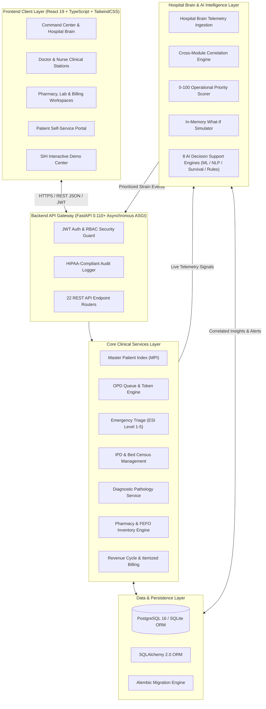
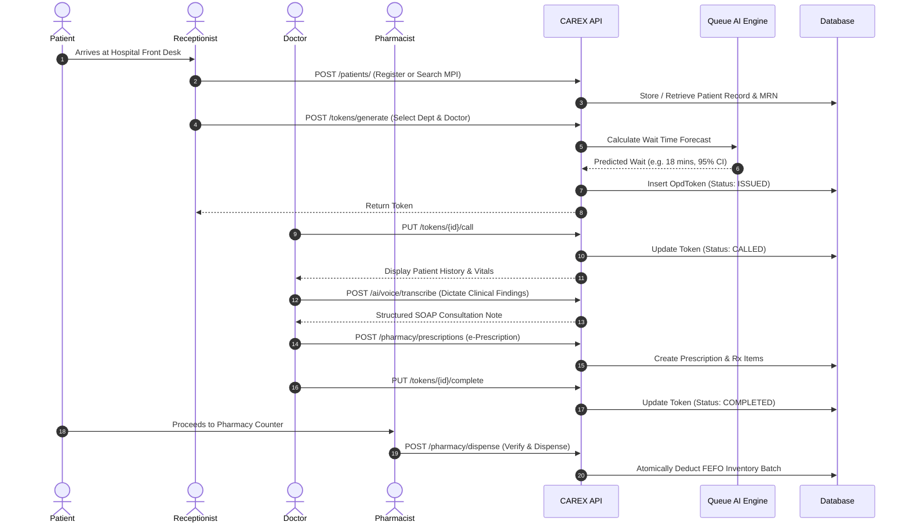
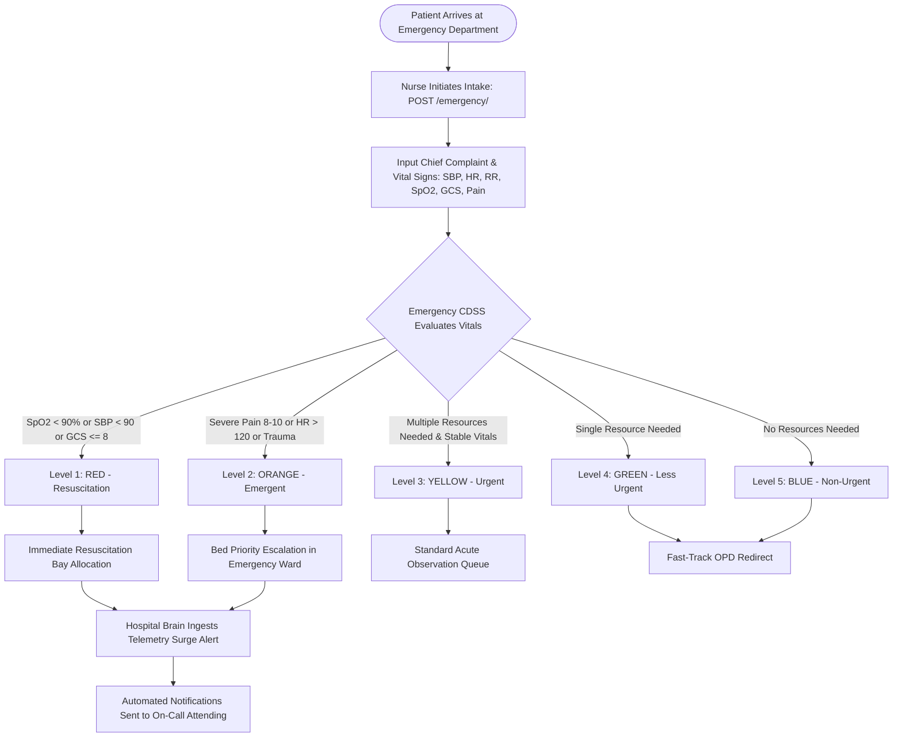
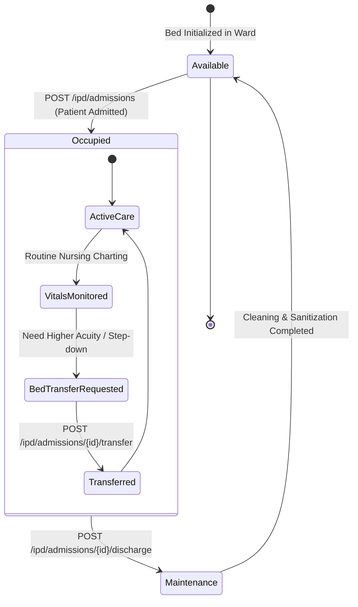
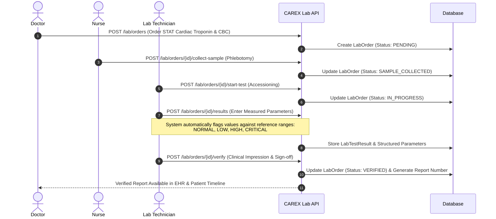
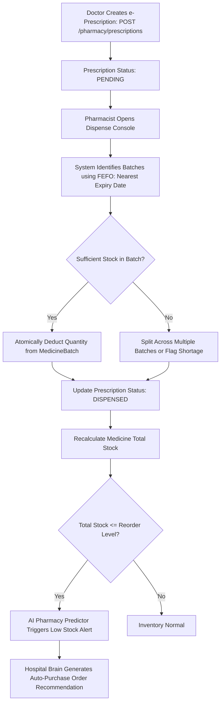
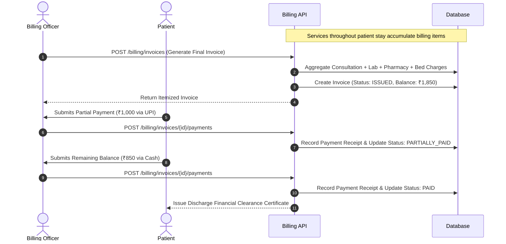
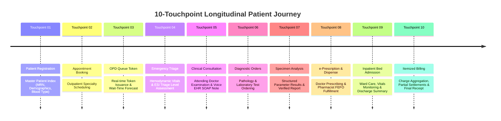
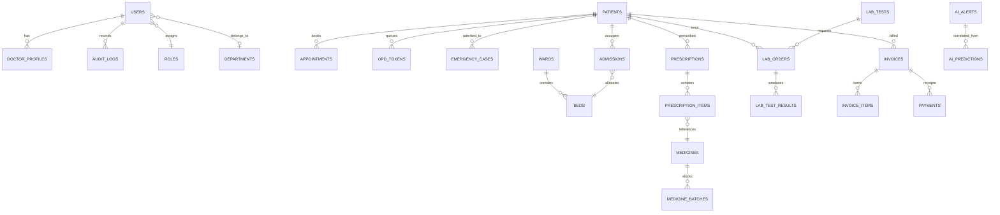

# CAREX — Comprehensive Master System Documentation & Architectural Flow Guide

---

## 📑 Table of Contents

1. [Executive Overview & Platform Vision](#1-executive-overview--platform-vision)
2. [High-Level System Architecture](#2-high-level-system-architecture)
3. [User Personas & Role-Based Access Control (RBAC)](#3-user-personas--role-based-access-control-rbac)
4. [Core Clinical & Operational Flows (With Flowcharts)](#4-core-clinical--operational-flows)
   - [Flow 1: Outpatient (OPD) Care Flow](#flow-1-outpatient-opd-care-flow)
   - [Flow 2: Emergency & Trauma Triage Flow](#flow-2-emergency--trauma-triage-flow)
   - [Flow 3: Inpatient (IPD) Admission & Bed Lifecycle](#flow-3-inpatient-ipd-admission--bed-lifecycle)
   - [Flow 4: Diagnostic Laboratory & Specimen Flow](#flow-4-diagnostic-laboratory--specimen-flow)
   - [Flow 5: Pharmacy, e-Prescribing & FEFO Dispensing](#flow-5-pharmacy-e-prescribing--fefo-dispensing)
   - [Flow 6: Billing & Revenue Cycle Settlement](#flow-6-billing--revenue-cycle-settlement)
   - [Flow 7: 10-Touchpoint Longitudinal Patient Care Journey](#flow-7-10-touchpoint-longitudinal-patient-care-journey)
5. [Hospital Brain Central Intelligence & AI Layer](#5-hospital-brain-central-intelligence--ai-layer)
   - [The 8 AI Clinical Decision Support Engines](#the-8-ai-clinical-decision-support-engines)
   - [Autonomous Cross-Module Correlation Engine](#autonomous-cross-module-correlation-engine)
   - [0–100 Operational Priority Scoring Algorithm](#0100-operational-priority-scoring-algorithm)
   - [Transparent Explainability Framework ("Why?" Modal)](#transparent-explainability-framework-why-modal)
   - [In-Memory What-If Capacity Simulation Engine](#in-memory-what-if-capacity-simulation-engine)
6. [SIH Demonstration Center & Flagship Scenario](#6-sih-demonstration-center--flagship-scenario)
7. [Database Architecture & Entity-Relationship Model](#7-database-architecture--entity-relationship-model)
8. [API Endpoint Catalog & Integration Reference](#8-api-endpoint-catalog--integration-reference)
9. [Installation, Verification & Quick Start Guide](#9-installation-verification--quick-start-guide)

---

## 1. Executive Overview & Platform Vision

**CAREX** is an enterprise-grade Hospital Operating System and Autonomous Coordination Platform designed for modern tertiary and multi-specialty healthcare networks. 

### Key Innovations:
- **Unified Hospital Operations**: Replaces disconnected departmental silos with seamless cross-functional workflows across OPD, Emergency, Inpatient Wards, Operating Theatres, Laboratories, Pharmacies, and Billing.
- **Autonomous Hospital Brain**: Continuously ingests live telemetry across all hospital departments to detect systemic bottlenecks, predict resource depletion, and calculate an auditable 0–100 operational strain index.
- **Explainable Multi-Modal AI Decision Support**: Embeds 8 specialized ML and heuristic engines with clear explainability ("Why was this flagged?"), risk categorization, and safety boundaries.
- **Zero-Mutation What-If Simulations**: Allows hospital administrators and clinical directors to simulate emergency surges (+20%), ICU stress (+10%), or discharge delays in-memory without corrupting database integrity.
- **Longitudinal Patient Journey**: Connects all 10 clinical and administrative touchpoints into a unified, interactive care timeline.

---

## 2. High-Level System Architecture

The CAREX platform follows a modern, decoupled three-tier micro-modular architecture:



---

## 3. User Personas & Role-Based Access Control (RBAC)

CAREX implements granular Role-Based Access Control across 8 distinct hospital roles. Every API request is verified through JSON Web Tokens (JWT) containing cryptographically signed claims and permission scopes.

| Persona / Role | Standard Email | Default Password | Permitted Endpoints & Primary Workspaces |
|:---|:---|:---|:---|
| 👑 **Super Admin** | `superadmin@carex.health` | `Carex#2026` | Full platform governance, user provisioning, system logs, Hospital Brain overview. |
| 🏢 **Hospital Admin** | `admin@carex.health` | `Carex#2026` | Executive Command Center, capacity management, What-If simulation, AI event triage. |
| 🩺 **Doctor** | `dr.sharma@carex.health` | `Carex#2026` | OPD consultations, e-Prescribing, voice EHR notes, lab orders, discharge summaries. |
| 💉 **Nurse** | `nurse.sarah@carex.health` | `Carex#2026` | Emergency triage intake, vital signs charting, bed transfers, SBAR shift handovers. |
| 🎫 **Receptionist** | `reception@carex.health` | `Carex#2026` | Master Patient Index registration, appointment booking, OPD token issuance, invoices. |
| 💊 **Pharmacist** | `pharmacy@carex.health` | `Carex#2026` | Prescription verification, FEFO batch dispensing, inventory replenishment, expiry audits. |
| 🔬 **Lab Technician** | `lab@carex.health` | `Carex#2026` | Specimen accessioning, analyzer telemetry, parameter range entry, report sign-off. |
| 🧑‍⚕️ **Patient** | `patient.john@carex.health` | `Carex#2026` | Personal health record timeline, live queue tracking, appointments, invoices. |

---

## 4. Core Clinical & Operational Flows

### Flow 1: Outpatient (OPD) Care Flow

The Outpatient workflow seamlessly guides patients from intake to consultation, prescription, and fulfillment:



---

### Flow 2: Emergency & Trauma Triage Flow

Emergency intake uses real-time vital sign scoring combined with the Emergency Severity Index (ESI) Decision Support model:



---

### Flow 3: Inpatient (IPD) Admission & Bed Lifecycle

Manages bed census, ward allocation, intermediate transfers, and multi-disciplinary discharge summaries:



---

### Flow 4: Diagnostic Laboratory & Specimen Flow

Covers the complete laboratory diagnostic lifecycle with structured reference range flagging and multi-stage verification:



---

### Flow 5: Pharmacy, e-Prescribing & FEFO Dispensing

Ensures patient medication safety, stock velocity forecasting, and First-Expiry-First-Out (FEFO) dispensing:



---

### Flow 6: Billing & Revenue Cycle Settlement

Aggregates consultation fees, diagnostic charges, pharmacy supplies, and room tariff into unified itemized invoices:



---

### Flow 7: 10-Touchpoint Longitudinal Patient Care Journey

CAREX synthesizes all patient encounters into an unbroken longitudinal care continuum:



---

## 5. Hospital Brain Central Intelligence & AI Layer

The **Hospital Brain** represents the pinnacle of autonomous hospital coordination in CAREX. It operates continuously above transactional databases to synthesize disparate department signals into unified executive intelligence.

```mermaid
graph LR
    subgraph Signal_Sources ["Departmental Telemetry Streams"]
        S1["OPD Queue Wait Times & Token Rates"]
        S2["Emergency Arrivals & Triage Red Counts"]
        S3["Inpatient & ICU Bed Occupancy %"]
        S4["Pharmacy Velocity & Low Stock Batches"]
        S5["Laboratory STAT Orders & Analyzer Backlogs"]
    end

    subgraph Correlation_Core ["Hospital Brain Intelligence Core"]
        Engine["Cross-Module Correlation Engine"]
        Scorer["0-100 Priority Scorer Formula"]
        Explain["Explainability Matrix ('Why?' Breakdown)"]
    end

    subgraph Output_Actions ["Executive Command & Action Center"]
        Alert["Prioritized Strain Events (CRITICAL / HIGH / MODERATE)"]
        Recom["Actionable Clinical & Resource Protocols"]
        Sim["What-If In-Memory Capacity Simulations"]
    end

    Signal_Sources --> Engine
    Engine --> Scorer
    Scorer --> Explain
    Explain --> Output_Actions
```



---

### The 8 AI Clinical Decision Support Engines

| # | Engine Name | Technology / Model Type | Clinical / Operational Function | Safety Boundary |
|:---:|:---|:---|:---|:---|
| **1** | **OPD Queue Wait-Time Forecast** | Gradient Boosted ML Regressor | Estimates consultation wait time based on queue length, doctor historical speed, and time-of-day. | Bounded [10, 180] mins; 95% Confidence Interval. |
| **2** | **Bed Capacity Horizon & LOS Risk** | Statistical Survival Model | Forecasts 6-hour and 24-hour ward and ICU occupancy rates; flags step-down candidates. | Informational capacity advisory only. |
| **3** | **Pharmacy Stockout Velocity Predictor** | Moving Average Consumption Velocity | Computes days-to-stockout and recommended Purchase Order replenishment quantities. | Alerts trigger at $\le 50\%$ reorder threshold. |
| **4** | **Emergency Triage CDSS** | Supervised ESI Classifier + Heuristics | Classifies emergency arrivals into Levels 1–5 based on vital signs (HR, SBP, RR, SpO2, GCS). | Hardcoded rule overrides: SpO2 < 90% $\rightarrow$ RED. |
| **5** | **Medical Document OCR / BioBERT NER** | Transformer Named Entity Recognition | Extracts diagnoses, medications, dosages, and lab parameters from medical reports. | Requires Attending MD verification sign-off. |
| **6** | **Voice-to-Note Whisper EHR** | Whisper ASR + Structured NLP | Transforms spoken clinical dictation into formatted SOAP notes. | Drafts require doctor review before saving. |
| **7** | **Nursing Shift Handover SBAR** | Deterministic Clinical Rule Engine | Compiles Situation, Background, Assessment, and Recommendation summaries for ward shifts. | Outgoing & Incoming nurse co-signatures required. |
| **8** | **Operational Flow Anomaly Detector** | Isolation Forest ML Detector | Unsupervised detection of unusual telemetry spikes (e.g. unexpected 400% lab surge). | Multi-signal cross-validation prevents false alarms. |

---

### 0–100 Operational Priority Scoring Algorithm

Every operational event in the Hospital Brain receives an objective priority score computed through a four-factor weighted formula:

$$\text{Priority Score} = w_1 \cdot S + w_2 \cdot R + w_3 \cdot C + w_4 \cdot T$$

Where:
- **Alert Severity ($S$, weight 30%)**: Critical = 100, High = 70, Medium = 40, Low = 10.
- **Resource Criticality & Impact ($R$, weight 25%)**: ICU / Trauma / Resuscitation = 100, Acute Wards = 75, General OPD = 40.
- **Cross-Module Correlation Density ($C$, weight 25%)**: Multilateral cascading impact across $\ge 3$ departments = 100; 2 departments = 65; 1 department = 30.
- **Time Horizon & Persistence ($T$, weight 20%)**: Active $\ge 4$ hours without resolution = 100; $1-4$ hours = 60; $< 1$ hour = 30.

#### Priority Ratings:
- **80 – 100**: `CRITICAL` (Immediate Executive & Department Head Intervention Required)
- **60 – 79**: `HIGH` (Operational Strain Requiring Resource Rebalancing)
- **40 – 59**: `MODERATE` (Elevated Activity Monitored by Charge Staff)
- **0 – 39**: `LOW` (Routine Operational Baseline)

---

### Transparent Explainability Framework ("Why?" Modal)

To eliminate "black box" AI distrust, every Hospital Brain event provides a granular, auditable explanation modal containing:
1. **What is Happening**: Clear statement of the active clinical bottleneck.
2. **What is Expected**: Historical baseline SLA and operational capacity benchmark.
3. **Why Flagged (Contributing Signals)**: Itemized telemetry triggers (e.g., *"+353% lab backlog increase"*, *"ICU available beds reduced to 1"*).
4. **Affected Departments & Resources**: Exact wards, clinics, or inventory SKUs involved.
5. **Recommended Operational Action**: Step-by-step clinical and resource intervention protocol.
6. **Safety Disclaimer**: Prominent CDSS clinical safety notice.

---

### In-Memory What-If Capacity Simulation Engine

Hospital executives can test contingency operational plans safely in real time without modifying production database tables:

- **Emergency Arrival Surge ($\Delta \%$)**: Injects simulated trauma arrivals and recalculates resuscitation bay stress.
- **ICU Occupancy Stress ($\Delta \%$)**: Simulates ICU bed saturation and step-down transfer requirements.
- **OPD Demand Surge ($\Delta \%$)**: Models clinic token backlog and calculates required overflow consultation chambers.
- **Discharge Acceleration Rate ($\Delta \%$)**: Models the relief on ward bed occupancy by expediting morning discharges.

---

## 6. SIH Demonstration Center & Flagship Scenario

The CAREX SIH Demo Center (`/admin/demo`) provides judges and evaluators with a deterministic, zero-friction demonstration environment:

### 7 One-Click Scenarios:
1. 🏆 **HOSPITAL_CAPACITY_CRISIS (Flagship Scenario)**: Simultaneously stresses Emergency (+250%), ICU (100% saturation), OPD (+180%), and Pharmacy (critical antibiotic depletion), activating the 6-stage Hospital Brain pipeline.
2. ⏱️ **OPD_OVERLOAD**: Simulates a 45% outpatient surge in Cardiology and Medicine clinics.
3. 🚨 **EMERGENCY_SURGE**: Simulates a multi-casualty trauma event with Priority Red arrivals.
4. 🛏️ **ICU_SATURATION**: Fills all ICU beds and triggers step-down candidate identification.
5. 💊 **PHARMACY_STOCKOUT**: Simulates zero-inventory depletion of critical injectable antibiotics.
6. 🔬 **LAB_BACKLOG**: Surges pending STAT cardiac enzyme orders on automated analyzers.
7. 🔄 **STABLE_HOSPITAL**: Restores the hospital to standard baseline operations.

### Zero-Side-Effect Demo Reset
Clicking **"Reset to Baseline"** atomically purges all injected simulation alerts (IDs `8801–8899`) while preserving genuine medical and patient records.

---

## 7. Database Architecture & Entity-Relationship Model

The CAREX database contains 20 interconnected relational entities mapped through SQLAlchemy ORM:



---

## 8. API Endpoint Catalog & Integration Reference

CAREX exposes 22 dedicated REST endpoint routers under `/api/v1`:

| Router Prefix | Primary Operations | Authentication Required |
|:---|:---|:---:|
| `/api/v1/auth` | Login, JWT Token Issuance, User Profile (`/me`), Password Management | Public / Bearer |
| `/api/v1/users` | User CRUD, Staff Directory, Department Role Assignments | Super Admin / Admin |
| `/api/v1/roles` | Role Metadata, Permission Matrices | Authenticated Staff |
| `/api/v1/departments` | Clinical Department Listings, Specialties, Capacity Targets | Authenticated Staff |
| `/api/v1/patients` | MPI Registration, Search, Allergies, Medical History, Journey Timeline | Receptionist / Doctor / Nurse / Patient |
| `/api/v1/doctors` | Doctor Profiles, Clinic Schedules, Consultation Availability | Authenticated Staff |
| `/api/v1/nurses` | Nurse Stations, Shift Rosters | Authenticated Staff |
| `/api/v1/appointments` | Booking, Rescheduling, Status Updates, Cancellation | Receptionist / Doctor / Patient |
| `/api/v1/tokens` | Token Issuance, Live Queue Tracking, Calling System, Consultation Finish | Receptionist / Doctor / Patient |
| `/api/v1/emergency` | Intake, Vital Signs Charting, ESI Triage Scoring, Resuscitation Bays | Nurse / Doctor / Admin |
| `/api/v1/ipd` | Inpatient Admissions, Bed Transfers, Clinical Discharge Summaries | Nurse / Doctor / Admin |
| `/api/v1/beds` | Bed Census, Heatmap, Ward Inventory, Cleaning Status Updates | Nurse / Doctor / Admin |
| `/api/v1/resources` | Equipment, Ventilators, Infusion Pumps, Operating Theatres | Authenticated Staff |
| `/api/v1/lab` | Test Catalog, Specimen Collection, Result Entry, Verification Sign-off | Lab Tech / Doctor |
| `/api/v1/pharmacy` | Medicine Catalog, Batch FEFO Stock, Prescriptions, Dispensing, Expiry | Pharmacist / Doctor |
| `/api/v1/billing` | Itemized Invoicing, Charge Aggregation, Partial/Full Payment Settlement | Receptionist / Billing / Admin |
| `/api/v1/notifications`| Role-Based Urgent Alerts, System Notices, Broadcast Dismissal | Authenticated Staff |
| `/api/v1/ai` | 8 ML/CDSS Inference Endpoints (Queue, Bed, Pharmacy, Triage, OCR, Voice, SBAR, Anomaly) | Authenticated Staff |
| `/api/v1/hospital-brain`| Executive Overview, Prioritized Event Feed, Explainability, What-If Simulation | Admin / Doctor / Nurse |
| `/api/v1/demo` | SIH Scenarios, Flagship Launch, 6-Stage Pipeline Progress, Baseline Reset | Authenticated Staff |
| `/api/v1/dashboard` | Role-Specific Tailored Dashboards (7 User Roles) | Authenticated Staff |
| `/api/v1/health` | Service Liveness, Database Connectivity, System Uptime | Public |

---

## 9. Installation, Verification & Quick Start Guide

### Prerequisites
- **Python**: 3.11+ / 3.12+ / 3.13+
- **Node.js**: 18+ / 20+ / 22+
- **Docker & Docker Compose** (Optional, for containerized deployment)

### Running via Docker Compose (Recommended)
```bash
docker-compose up --build
```
- **Frontend App**: `http://localhost:3000` or `http://localhost`
- **Backend API & Swagger Docs**: `http://localhost:8000/api/v1/docs`

---

### Running Locally (Step-by-Step)

#### Step 1: Backend Setup & Database Seeding
```powershell
# Navigate to backend directory
cd backend

# Create and activate Python virtual environment
python -m venv venv
.\venv\Scripts\Activate.ps1    # On Windows
# source venv/bin/activate     # On Linux / macOS

# Install dependencies
pip install -r requirements.txt

# Apply database migrations & seed comprehensive hospital dataset
alembic upgrade head
python -m app.utils.seed

# Start the FastAPI ASGI server
uvicorn app.main:app --reload --host 0.0.0.0 --port 8000
```

#### Step 2: Frontend Setup
```powershell
# In a new terminal, navigate to frontend directory
cd frontend

# Install Node dependencies
npm install

# Start the Vite development server
npm run dev
```
*The web application will open at `http://localhost:5173`.*

---

### Automated Verification & Testing Commands

#### 1. Backend Pytest Unit & Integration Suite (54 Tests)
```powershell
cd backend
.\venv\Scripts\pytest tests/ -v
```
*Expected Result: `54 passed in ~23s` (100% pass rate).*

#### 2. Comprehensive Multi-Role Integration Diagnostic Suite
```powershell
cd backend
.\venv\Scripts\python.exe tests/test_comprehensive_suite.py
```
*Expected Result: Verifies all 8 personas, 22 endpoints, and clinical flows.*

#### 3. Frontend Production Build & TypeScript Typecheck
```powershell
cd frontend
npm run build
```
*Expected Result: Bundled with 0 TypeScript compilation errors.*

---

## 10. Summary & Conclusion

CAREX bridges the critical gap between routine electronic medical records and autonomous, predictive hospital orchestration. With its **Hospital Brain**, **Transparent Explainability**, **8 Clinical AI Engines**, **What-If Capacity Simulations**, and **Longitudinal Patient Journey**, CAREX establishes a new standard for high-reliability, data-driven healthcare systems.
