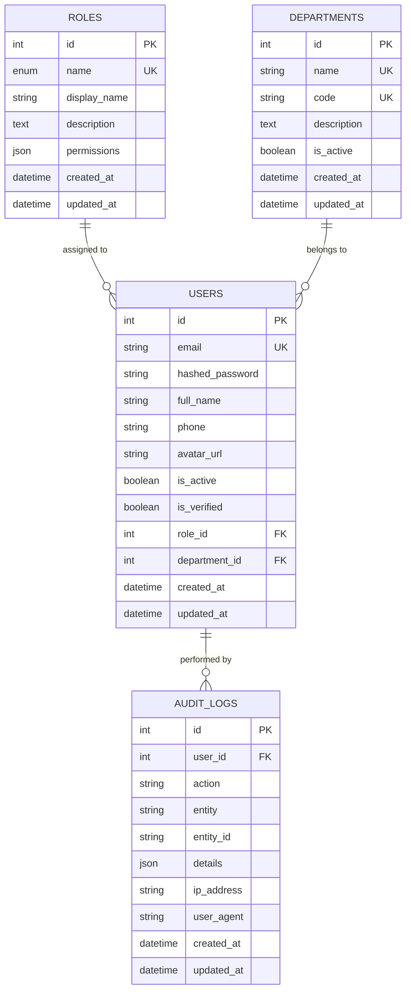

# CAREX — Database Design & Schema Documentation (Phase 1)

This document details the database schema, entity relationships, indexes, and migration commands for Phase 1 of CAREX.

---

## 1. Entity Relationship Diagram (ERD)



---

## 2. Table Definitions

### 2.1 `roles`
Stores system RBAC definitions and permission lists.
- `id` (INT, Primary Key)
- `name` (VARCHAR/ENUM, Unique, Not Null, Indexed): Role identifier (`SUPER_ADMIN`, `HOSPITAL_ADMIN`, `DOCTOR`, `NURSE`, `RECEPTIONIST`, `PHARMACIST`, `LAB_TECHNICIAN`, `PATIENT`).
- `display_name` (VARCHAR(100), Not Null): Human-readable name.
- `description` (TEXT, Nullable): Role responsibility summary.
- `permissions` (JSON, Not Null): Array of permission strings (e.g. `["patients:read", "prescriptions:write"]`).
- `created_at` / `updated_at` (TIMESTAMP WITH TIME ZONE).

### 2.2 `departments`
Stores clinical wards, outpatient departments, and operational units.
- `id` (INT, Primary Key)
- `name` (VARCHAR(100), Unique, Not Null, Indexed): Department name.
- `code` (VARCHAR(20), Unique, Not Null, Indexed): Department shortcode (e.g., `EMERGENCY`, `CARDIOLOGY`).
- `description` (TEXT, Nullable).
- `is_active` (BOOLEAN, Default: `True`).
- `created_at` / `updated_at` (TIMESTAMP WITH TIME ZONE).

### 2.3 `users`
Stores user accounts for hospital staff, doctors, administrators, and patients.
- `id` (INT, Primary Key)
- `email` (VARCHAR(255), Unique, Not Null, Indexed): Case-insensitive email address.
- `hashed_password` (VARCHAR(255), Not Null): Salted bcrypt password hash.
- `full_name` (VARCHAR(255), Not Null): User's legal/clinical full name.
- `phone` (VARCHAR(50), Nullable): Contact phone number.
- `avatar_url` (VARCHAR(500), Nullable): Profile image URL.
- `role_id` (INT, Foreign Key -> `roles.id`, On Delete RESTRICT, Not Null).
- `department_id` (INT, Foreign Key -> `departments.id`, On Delete SET NULL, Nullable).
- `is_active` (BOOLEAN, Default: `True`).
- `is_verified` (BOOLEAN, Default: `True`).
- `created_at` / `updated_at` (TIMESTAMP WITH TIME ZONE).

### 2.4 `audit_logs`
Stores immutable compliance and access tracking records for HIPAA requirements.
- `id` (INT, Primary Key)
- `user_id` (INT, Foreign Key -> `users.id`, On Delete SET NULL, Nullable, Indexed).
- `action` (VARCHAR(100), Not Null, Indexed): e.g., `LOGIN_SUCCESS`, `CREATE_USER`, `VIEW_PATIENT`.
- `entity` (VARCHAR(100), Not Null, Indexed): e.g., `AUTH`, `USER`, `DEPARTMENT`.
- `entity_id` (VARCHAR(100), Nullable): Target object identifier.
- `details` (JSON, Nullable): Payload or modification attributes.
- `ip_address` (VARCHAR(50), Nullable): Client IP address.
- `user_agent` (VARCHAR(255), Nullable): Browser / client string.
- `created_at` / `updated_at` (TIMESTAMP WITH TIME ZONE).

---

## 3. Database Migrations (Alembic)

### Running Migrations
```bash
cd backend
alembic upgrade head
```

### Creating New Migrations
```bash
cd backend
alembic revision --autogenerate -m "Add new clinical tables"
```

### Rollback
```bash
cd backend
alembic downgrade -1
```

---

## 4. Seeding Demo Data
To populate the database with default roles, departments, and 8 demo accounts:
```bash
cd backend
python -m app.utils.seed
```
